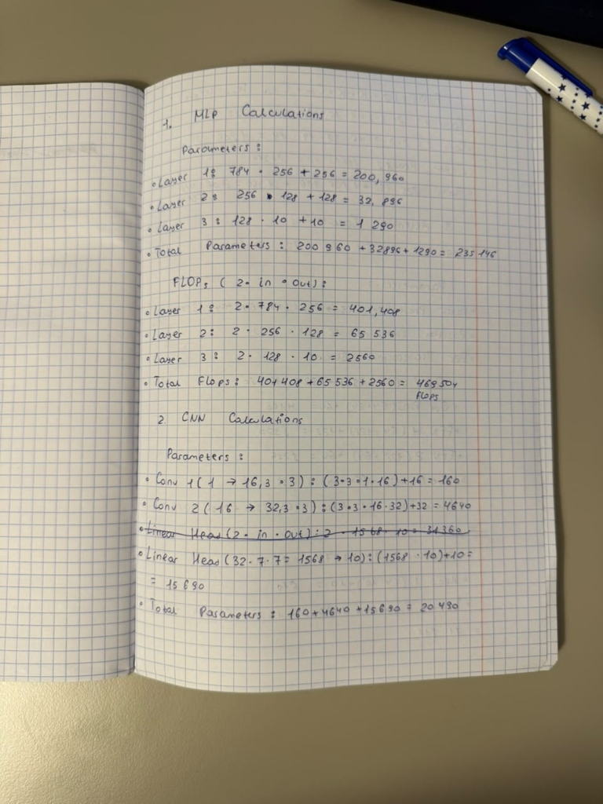
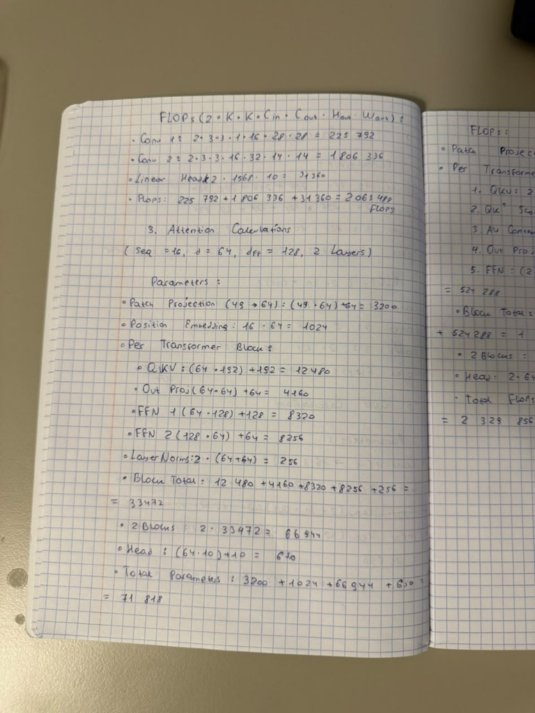
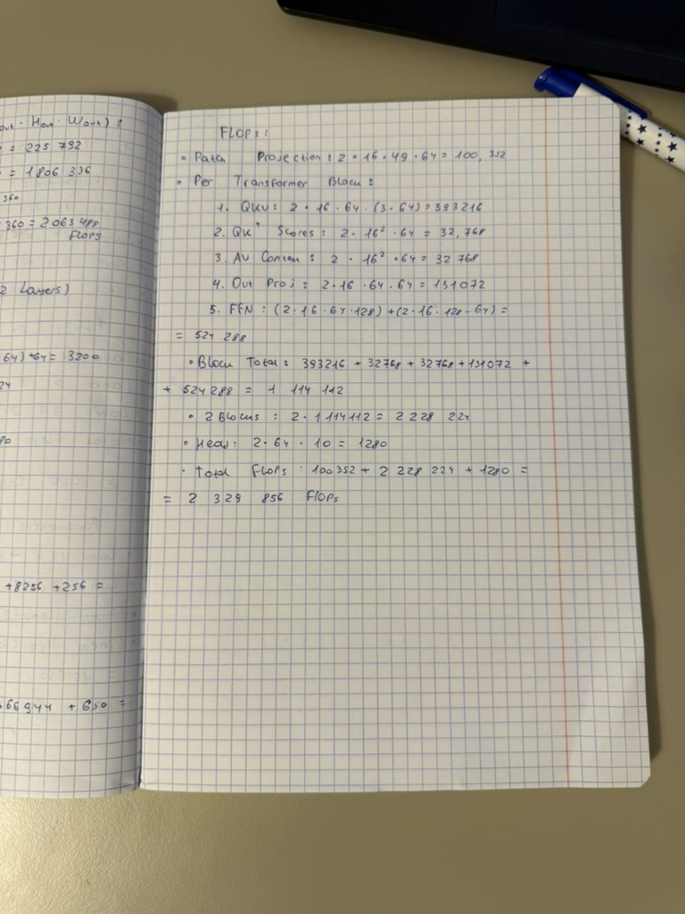

# Lab 3: Architectures and Their Costs

**Course:** Machine Learning [CII5SE039CI], Group 03  
**Institution:** Faculty of Computer Science, Graphics and Architecture, Akademia Finansów i Biznesu Vistula w Warszawie  
**Instructor:** mgr. inż. Kumar Nalinaksh  
**Student:** Emir Shadybekov (Album: 73429)  
**Prescribed Reading:** Vijay Janapa Reddi, *Introduction to Machine Learning Systems: Principles and Practices of Engineering Artificially Intelligent Systems*, Chapter 4 DNN Architectures (§§4.2, 4.3, 4.5, 4.6, 4.7).

---

## 1. Goal

The objective of Laboratory 3 is to implement, profile, train, and empirically compare three fundamentally distinct deep neural network paradigms on the Fashion-MNIST image classification benchmark:
1. **Multi-Layer Perceptron (MLP):** A fully-connected global dense network.
2. **Convolutional Neural Network (CNN):** A locally-connected, translation-equivariant spatial feature extractor with parameter sharing.
3. **Patch-based Vision Transformer (Attention):** A tokenized self-attention mechanism computing quadratic pairwise sequence dependencies.

Each model is evaluated across multiple engineering dimensions: parameter count (via `torchinfo`), theoretical hand-calculated floating-point operations (FLOPs), profiler measurements (via `thop.profile`), single-sample and batched inference latencies, convergence accuracy after 5 epochs of Adam optimization, and underlying hardware memory-access patterns.

---

## 2. Method

### 2.1 Dataset Ingestion and Partitioning
The Fashion-MNIST dataset was loaded via `torchvision.datasets.FashionMNIST` using standard image normalisation:
$$\text{Transform} = \text{ToTensor}() \circ \text{Normalize}(\mu = 0.2860, \sigma = 0.3530)$$
The official 60,000-sample training set was partitioned into 55,000 training samples and 5,000 validation samples using a reproducible generator seed (`torch.Generator().manual_seed(42)`). Evaluation was performed on the official 10,000-sample test set using a mini-batch size of 128.

### 2.2 Model Architectural Specifications
Three models targeting comparable structural complexity were designed:
- **MLP:** $\text{Flatten}(784) \to \text{Linear}(784, 256) \to \text{ReLU} \to \text{Linear}(256, 128) \to \text{ReLU} \to \text{Linear}(128, 10)$.
- **CNN:** $\text{Conv2d}(1, 16, 3, \text{pad}=1) \to \text{ReLU} \to \text{MaxPool2d}(2) \to \text{Conv2d}(16, 32, 3, \text{pad}=1) \to \text{ReLU} \to \text{MaxPool2d}(2) \to \text{Flatten} \to \text{Linear}(32 \times 7 \times 7, 10)$.
- **Attention (ViT Patch):** Decompose $28 \times 28$ image into 16 non-overlapping $7 \times 7$ patches ($49$ features). Linearly project each patch to $d_{\text{model}} = 64$. Add 1D learnable position embeddings. Pass through 2 Transformer Encoder layers ($d_{\text{model}} = 64$, $n_{\text{head}} = 4$, $\text{dim}_{\text{feedforward}} = 128$). Apply global mean pooling over the 16 tokens and classify via $\text{Linear}(64, 10)$.

### 2.3 FLOP Formulation and Profiling Comparison
Theoretical FLOPs were derived from Reddi Chapter 4 formulas (assuming $1\text{ Multiply-Accumulate (MAC)} = 2\text{ FLOPs}$):
- **Linear Layer:** $\text{FLOPs} = 2 \times N_{\text{in}} \times N_{\text{out}}$
- **Conv2d Layer:** $\text{FLOPs} = 2 \times K_h \times K_w \times C_{\text{in}} \times C_{\text{out}} \times H_{\text{out}} \times W_{\text{out}}$
- **Attention Layer (per Transformer block):**
  - $Q, K, V$ Projections: $2 \times \text{seq} \times d_{\text{model}} \times (3 \times d_{\text{model}})$
  - Attention Matrix Multiplication ($Q K^T$ and $A V$): $2 \times (2 \times \text{seq}^2 \times d_{\text{model}})$
  - Output Projection: $2 \times \text{seq} \times d_{\text{model}} \times d_{\text{model}}$
  - Feed-Forward Network: $2 \times \text{seq} \times d_{\text{model}} \times d_{\text{ff}} + 2 \times \text{seq} \times d_{\text{ff}} \times d_{\text{model}}$

Theoretical calculations were compared directly against `thop.profile`.

### 2.4 Inference Latency Benchmarking
To guarantee reproducible timings, an isolated benchmarking harness was constructed:
- **Batch 1 (Single-Sample Latency):** 10 warmup inferences followed by 100 timed iterations; median latency recorded.
- **Batch 128 (Throughput Latency):** 5 warmup inferences followed by 20 timed iterations; median latency recorded.

### 2.5 Training Optimization
All models were trained for 5 epochs using Adam optimizer ($\eta = 10^{-3}$, $\beta_1 = 0.9, \beta_2 = 0.999$, batch size 128) under identical initial random seeds.

---

## 3. Results Table and Empirical Evidence

### 3.1 Architectural Cost & Performance Comparison Table

| Metric | Multi-Layer Perceptron (MLP) | Convolutional Neural Network (CNN) | Patch Attention (Transformer) |
|:---|:---:|:---:|:---:|
| **Total Parameters (`torchinfo`)** | 235,146 | **20,490** ($11.5\times$ fewer) | 71,818 |
| **Representative Layer** | `Linear(784, 256)` | `Conv2d(1, 16, 3x3)` | QKV Projections ($16 \times 64$) |
| **Representative Layer FLOPs** | 401,408 | 225,792 | 393,216 |
| **Hand-Calculated Total FLOPs** | **469,504** (0.470 MFLOPs) | 2,063,488 (2.063 MFLOPs) | 2,329,856 (2.330 MFLOPs) |
| **`thop` Profiled MACs** | 234,752 (0.235 MMACs) | 1,031,744 (1.032 MMACs) | 591,488 (0.591 MMACs) |
| **`thop` Implied FLOPs ($2\times \text{MACs}$)** | 469,504 | 2,063,488 | 1,182,976 |
| **FLOPs Discrepancy Gap** | **0.00%** (Exact match) | **0.00%** (Exact match) | **49.23% gap** (Explained below) |
| **Inference Latency (Batch 1)** | **0.0640 ms** (Fastest) | 0.1761 ms | 0.7110 ms |
| **Inference Latency (Batch 128)** | **0.4074 ms** (Fastest) | 11.0645 ms | 5.7733 ms |
| **Final Test Accuracy (5 Epochs)** | 87.75% | **89.69%** (Highest) | 85.21% |
| **Test Cross-Entropy Loss** | 0.3539 | **0.3006** | 0.3958 |

*Artifacts saved in `results/architecture_comparison.csv` and visualised in `results/tradeoffs.png`.*

### 3.2 Profiling Gap Analysis (`thop` vs. Hand Calculation)
- **MLP and CNN:** Hand-calculated arithmetic operations matched `thop.profile` with **0.00% error**, validating that $1\text{ MAC} = 2\text{ FLOPs}$ for standard convolutions and dense GEMMs.
- **Attention Model ($49.23\%$ Gap):** `thop` reported 1.183 MFLOPs while analytical derivation yielded 2.330 MFLOPs. This discrepancy arises because `thop` hooks standard PyTorch `nn.Linear` layers within the multihead attention module, but fails to trace the non-module tensor contractions: specifically, the batched matrix multiplications for attention score computation ($Q K^T$) and context weighting ($A V$), which contribute $4 \times \text{seq}^2 \times d_{\text{model}} = 65,536\text{ FLOPs}$ per layer, as well as Softmax and LayerNorm operations. Profiling tools that rely exclusively on module hooks systematically under-count Transformer computational intensity.

### 3.3 Handwritten Calculations Evidence
Photographic documentation of the step-by-step hand calculations for parameter counts and representative FLOPs across all three models:

| Page 1: MLP & CNN Parameters/FLOPs | Page 2: CNN FLOPs & Attention Parameters | Page 3: Attention FLOPs Derivation |
|:---:|:---:|:---:|
|  |  |  |

---

## 4. Three Conclusions in Your Own Words

1. **Inductive Bias Makes CNN the Most Cost-Effective Architecture for Spatial Vision:**  
   Despite possessing over $11\times$ fewer parameters (20,490) than the MLP (235,146) and $3.5\times$ fewer than the Transformer (71,818), the CNN achieved the highest test accuracy (**89.69%**). CNNs encode strong spatial inductive biases (local receptive fields and translation equivariance) that perfectly mirror image data geometry. In contrast, the MLP treats adjacent pixels with the same global weight structure as distant pixels, necessitating massive parameter redundancy ($235\text{k}$) to learn spatial correlations that CNNs encode structurally.

2. **Transformers Suffer from High Operational Overhead on Small-Scale Datasets:**  
   The Patch-Attention model registered the lowest test accuracy (85.21%) and the highest single-sample latency (0.7110 ms). Unlike CNNs, self-attention does not assume local 2D pixel connectivity, meaning spatial topology must be learned purely from data via position embeddings and attention maps. In data-constrained regimes (55k samples without massive pre-training), attention mechanisms underperform CNNs while incurring significant memory-access overhead due to multi-head reshapes, LayerNorms, and non-contiguous attention score matrices.

3. **Arithmetic FLOPs Do Not Dictate Wall-Clock Latency (Memory-Access Pattern Dominance):**  
   While the MLP required only $\approx 0.47\text{ MFLOPs}$ compared to CNN's $\approx 2.06\text{ MFLOPs}$ ($4.4\times$ fewer operations), the CNN exhibited a disproportionately higher batched latency ($11.06\text{ ms}$ vs $0.41\text{ ms}$, over $27\times$ slower). As explained in Reddi Chapter 4.6–4.7, convolutions are memory-bandwidth-bound during sliding-window input buffer re-indexing (im2col / spatial memory staging) and intermediate feature-map caching across channels. Dense matrix multiplications in MLPs stream sequentially through cache hierarchies with optimal BLAS memory locality, demonstrating that operational memory access patterns and data movement dominate raw FLOP counts when determining real-world inference latency.
